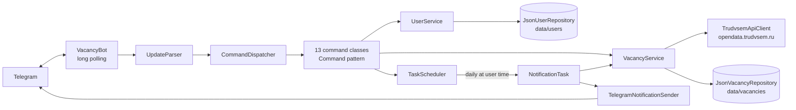

# Vacancy Tracker Bot

A Telegram bot that watches for new job vacancies. You describe what you are looking for and when you want to be
notified; once a day the bot queries the open API of the Russian federal job portal
[opendata.trudvsem.ru](https://opendata.trudvsem.ru) and sends you the matching vacancies at the chosen time.

> The bot talks to users in Russian, because the data source covers Russian regions and vacancies. Everything else
> (code, documentation, comments) is in English.

Final project of the Skillbox "Advanced Java Core" course. Built solo.

## Features

- user registration and a per-user time zone (`UTC+3`, `UTC+3:30`, ...)
- search filters: region, minimum experience, minimum salary, keywords
- every setting works both with inline buttons and with typed commands
- a daily search scheduled in the user's own time zone
- paginated results (10 vacancies per page)
- settings and found vacancies are stored as JSON files; scheduled tasks are restored after a restart
- `/stop` unsubscribes the user and deletes all of their data

## Architecture



Three layers with one-way dependencies:

| Package | Layer | Responsibility |
|---|---|---|
| `presentation` | presentation | receiving updates, commands, keyboards, message formatting |
| `service` | business logic | vacancy search, scheduling, user management |
| `repository` | data access | reading and writing JSON files |
| `model`, `exception` | shared | data models and custom exceptions |

The presentation layer only talks to services; repositories are reachable only from the business layer.
Each bot command is a separate class implementing `BotCommand`, and `CommandDispatcher` picks the first one that
supports the incoming request (Command pattern, easy to extend without touching existing code).
`ScheduledTaskRestorer` re-creates every user's daily task on startup.

## Bot commands

| Command | Purpose |
|---|---|
| `/start` | register and show the greeting |
| `/menu` | main menu with the search criteria |
| `/region 78` | choose a region by its code (or pick it from the paginated list) |
| `/experience 3` | minimum experience in years |
| `/salary 75000` | minimum salary |
| `/keyword Java` | search keywords (`/keyword` with no argument offers to clear them) |
| `/notify 7 15` | daily notification time (hours and minutes) |
| `/ready` | confirm the settings and start the daily search |
| `/vacancies` | show the latest found vacancies |
| `/stop` | unsubscribe and delete all data |
| `UTC+3` | change the time zone (typed without a slash) |

## Run it

You need a bot token. It is free: open [@BotFather](https://t.me/BotFather) in Telegram, send `/newbot` and follow the
prompts. You will get a bot name and a token.

### Option A: Docker (no Java needed)

```bash
cp .env.example .env        # then put BOT_NAME and BOT_TOKEN into .env
docker compose up -d --build
docker compose logs -f bot  # "Бот ... запущен" means it is running
```

User data is kept in the `bot-data` Docker volume.

### Option B: Gradle (Java 21)

```bash
cp src/main/resources/application.properties.example src/main/resources/application.properties
# fill in bot.name and bot.token, or use environment variables instead:
#   BOT_NAME, BOT_TOKEN, STORAGE_PATH (default: data)
./gradlew run
```

`application.properties` and `.env` are git-ignored, so the token never reaches the repository.

## Demo walkthrough (about 2 minutes)

1. Send `/start`. The bot greets you and shows the menu.
2. Send `UTC+4` (or your own offset) to set the time zone.
3. Choose a region with the menu buttons, or `/region 78`.
4. Set the filters: `/salary 70000`, `/experience 1`, `/keyword Java`.
5. Pick a notification time **two minutes from now**, for example `/notify 18 42`, so the notification arrives during
   the demo.
6. Send `/ready`. The bot confirms the schedule and lists the criteria it will search for.
7. Wait for the notification, then use the "next page" button, or send `/vacancies` to see the saved results.
8. Restart the bot (`docker compose restart bot`) and show that the schedule is restored from `data/`.
9. `/stop` removes the user and all of their files.

## Tests

```bash
./gradlew test                           # unit tests (26 test classes, no network, no Telegram)
./gradlew jacocoTestCoverageVerification # fails if coverage is below 80%
```

The coverage report is written to `build/reports/jacoco/test/html/index.html`. The same checks run in GitHub Actions on
every push and pull request, together with a Docker image build.

## Data storage

| Path | Content |
|---|---|
| `data/users/{userId}.json` | user settings and filters |
| `data/vacancies/{userId}.json` | latest found vacancies |
| `logs/bot.log` | application log |

Directories are created automatically on the first start.

## Tech stack

Java 21, Gradle, telegrambots 8.0 (long polling), Jackson, Lombok, SLF4J + Logback, JUnit 5, Mockito, AssertJ, JaCoCo,
Docker, GitHub Actions.
